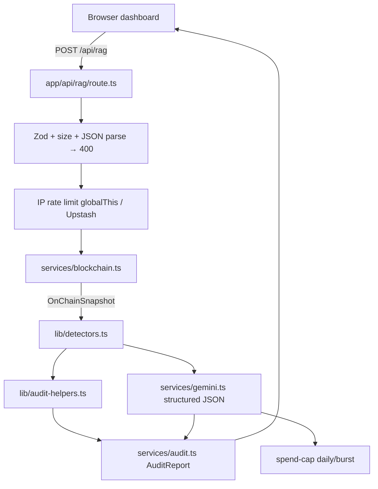

# AegisWeb3 — Multi-Chain Risk Agent

Paste a wallet or contract address → **deterministic RPC flags** + optional **AI interpretive brief** → plain-English verdict (`Do Not Sign` / `Caution — Revoke First` / `Safe to Proceed with size-cap`).

No wallet connect. No seed. No fabricated vulnerability theater.

**Live demo:** [web3-risk-agent.vercel.app](https://web3-risk-agent.vercel.app/) · Architected by **Chris Traios**.

---

## System architecture



| Layer | Path | Role |
| --- | --- | --- |
| UI | `app/page.tsx`, `components/*` | Verdict strip, checked/not-checked, feed, compliance footer |
| API | `app/api/rag/route.ts` | Validate → rate-limit → audit |
| Deterministic | `services/blockchain.ts`, `lib/detectors.ts` | RPC facts + evidence-backed flags only |
| AI | `services/gemini.ts`, `lib/prompt-guard.ts` | Interpretive JSON; never invents RPC facts |
| Docs | `docs/PROJECT_MEMORY.md`, `COMPANY_OS/*` | Architecture + legal/security ledger |

---

## Deterministic vs AI risk pipeline

1. **RPC snapshot** (`eth_getCode` / Solana `getAccountInfo`) with `AbortSignal.timeout`. Failures → `completeness: UNAVAILABLE | PARTIAL` — **no invented flags**.
2. **Detectors** emit flags with `source`, `evidence`, confidence, and optional “common on legit”.
3. **Score** is derived only from RPC-sourced severities (`null` when unscorable).
4. **Verdict** is local + optionally tightened by AI `suggestedVerdict`.
5. **AI** may add interpretive flags tagged `ai:interpretive` or be skipped under spend cap / timeout.

**Honesty rules:** `CLEAN ≠ SAFE` always shown. Approvals are **not** enumerated in paste mode — UI deep-links to revoke.cash / Rabby. Quick Target EIP-55 address is labeled as **checksum demo**, not “High-Risk honeypot”.

---

## Threat model & security controls

| Threat | Control |
| --- | --- |
| Secret exfiltration via browser | Server-only env (`GEMINI_*`, RPC URLs); no `NEXT_PUBLIC_` secrets |
| Prompt injection via address | `lib/prompt-guard.ts` sanitize + charset clamp |
| Abuse / cost blowup | IP RL 10/min; Gemini daily + burst caps (`lib/spend-cap.ts`); optional Upstash |
| Malformed clients | JSON parse / size → **400** (never 500); Zod address validation |
| Clickjacking / MIME / referrer | CSP + `X-Frame-Options` + `X-Content-Type-Options` + `Referrer-Policy` + `Permissions-Policy` in `next.config.ts` |
| Upstream hang | RPC 8s timeout; Gemini race-timeout |

---

## API contract

`POST /api/rag`

**Request**

```json
{ "query": "0xA0b86991c6218b36c1d19D4a2e9Eb0cE3606eB48", "chain": "ethereum" }
```

`chain`: `solana` | `ethereum` | `base` | `bnb`. Legacy `address` field accepted as alias for `query`.

**Success `200`**

```json
{
  "report": {
    "address": "...",
    "chain": "ETHEREUM",
    "completeness": "PARTIAL",
    "checked": ["rpc:eth_getCode", "..."],
    "notChecked": ["token approvals / allowance enumeration", "..."],
    "riskScore": 18,
    "threatLevel": "Low Risk",
    "verdict": "SAFE_TO_PROCEED_WITH_SIZE_CAP",
    "verdictReason": "...",
    "nextAction": "...",
    "flags": [{ "id": "...", "title": "...", "severity": "info", "confidence": "H", "evidence": "...", "source": "rpc:eth_getCode" }],
    "aiSummary": "... or null",
    "cleanIsNotSafeNote": "...",
    "methodologyPath": "/methodology"
  },
  "answer": "legacy plain-text concatenation"
}
```

| Status | When |
| --- | --- |
| `400` | Malformed JSON, oversized body, Zod/address failure |
| `429` | IP rate limit or AI spend/burst cap |
| `500` | Unexpected server failure (no secrets in body) |

---

## Regulatory disclaimers

Product footer + `/methodology` state:

- **Non-financial / non-audit advice**
- **AI-assisted transparency** under Regulation (EU) **2024/1689** — [EUR-Lex](https://eur-lex.europa.eu/eli/reg/2024/1689/oj)
- **Not a MiCA CASP** under Regulation (EU) **2023/1114** — [EUR-Lex](https://eur-lex.europa.eu/eli/reg/2023/1114/oj)
- **Zero seed / private-key storage** (GDPR data minimization posture)

Citations verified 2026-11-18 via Firecrawl on `eur-lex.europa.eu` (see `COMPANY_OS/03_LEGAL_&_AADE_COMPLIANCE.md`). Not legal advice — human counsel required for commercial EU claims.

---

## Local setup & testing

```bash
npm install
cp .env.example .env.local
# set GEMINI_API_KEY + *_RPC_URL (server-only)
npm run lint
npm run build
npm run dev
```

| Variable | Purpose |
| --- | --- |
| `GEMINI_API_KEY` | Google Gemini |
| `GEMINI_MODEL` | Optional (default `gemini-2.0-flash`) |
| `GEMINI_DAILY_CAP` / `GEMINI_BURST_CAP` | Optional spend limits |
| `SOLANA_RPC_URL` / `ETHEREUM_RPC_URL` / `BASE_RPC_URL` / `BNB_RPC_URL` | JSON-RPC |
| `UPSTASH_REDIS_REST_URL` + `UPSTASH_REDIS_REST_TOKEN` | Optional durable RL + spend |

**Smoke checks**

1. Scan Circle USDC Quick Target → contract bytecode flag, honest verdict.
2. Scan EIP-55 demo → EOA or contract facts only; label is “checksum demo”.
3. `curl` malformed body → `400` `{ "error": "Malformed JSON body." }`.
4. Disconnect RPC / omit env → UI shows `UNAVAILABLE` / `PARTIAL`, not fake Critical flags.

## Scripts

| Command | Description |
| --- | --- |
| `npm run dev` | Local development |
| `npm run build` | Production build |
| `npm run start` | Serve production build |
| `npm run lint` | ESLint |
